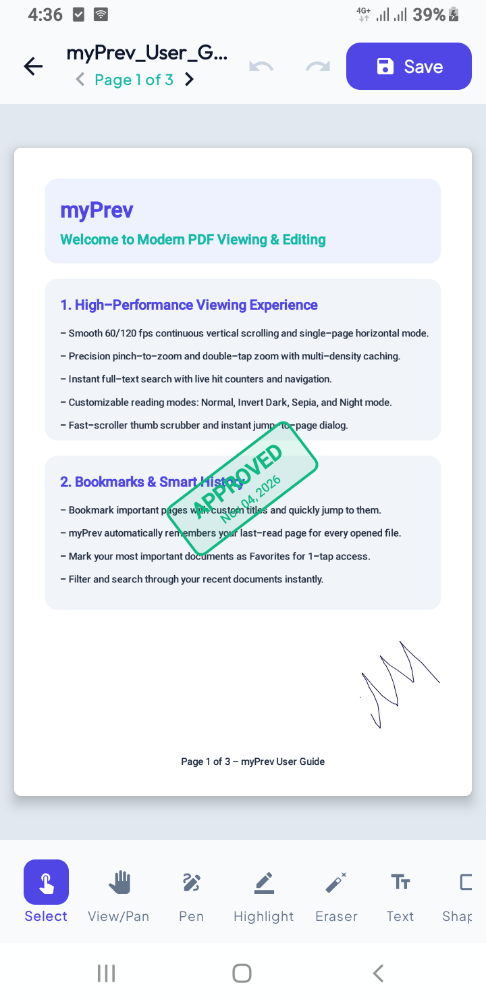

# myPrev — PDF Viewer, Editor & Toolbox

> **View. Edit. Sign.**  
> A production-grade, privacy-first, 100% offline Android PDF Viewer and Editor built with Kotlin and Jetpack Compose.

---

## 🎬 App Demo

<p align="center">
  <a href="https://youtube.com/shorts/XxgXQplDs80">
    
  </a>
</p>
*Click the screenshot above to watch the app in action on YouTube.*

---

## 🏛 Architecture Diagram

myPrev strictly follows Google's official Android Architecture Guide (Clean Architecture + MVVM + Unidirectional Data Flow):

```
┌─────────────────────────────────────────────────────────────┐
│                      Presentation Layer                     │
│  - Jetpack Compose M3 UI (Theme.kt, Color.kt, Type.kt)      │
│  - Navigation Compose (Type-safe routes & Predictive Back)  │
│  - ViewModels (HomeViewModel, ViewerViewModel,             │
│                EditorViewModel, ToolsViewModel)             │
│  - Unidirectional Data Flow: UiState -> Composable -> Event │
└──────────────────────────────┬──────────────────────────────┘
                               │ Observes Flows / Dispatches Events
┌──────────────────────────────▼──────────────────────────────┐
│                         Domain Layer                        │
│  - PdfEngine (Thread-safe rendering session & LRU Cache)    │
│  - PdfToolsEngine (Merge, Split, Compress, Watermark, etc.) │
│  - UndoRedoManager (Non-destructive canvas history)         │
│  - Use Cases & Data Mappings                                │
└──────────────────────────────┬──────────────────────────────┘
                               │ Repository Pattern
┌──────────────────────────────▼──────────────────────────────┐
│                          Data Layer                         │
│  - Room Database (PdfDocumentEntity, Bookmark, Signature)   │
│  - DAOs (PdfDocumentDao, BookmarkDao, SignatureDao)         │
│  - DataStore Preferences (Theme, Dynamic Color, ViewMode)   │
│  - Storage Access Framework (SAF - Scoped Storage)          │
│  - Local PDF Render Cache & Temporary File Handlers         │
└─────────────────────────────────────────────────────────────┘
```

---

## 🛠 Tech Stack

- **Language:** Kotlin 2.2.10
- **UI Framework:** 100% Jetpack Compose with Material Design 3 (Material You)
- **Min SDK:** 24 (Android 7.0) | **Target SDK:** 37 (Android 17)
- **Dependency Injection:** Container Injection (`AppContainer` / `DefaultAppContainer`)
- **Concurrency & Reactivity:** Kotlin Coroutines & `StateFlow`
- **Local Persistence:** Room Database 2.7.0 (KSP code-gen)
- **Preferences:** Jetpack DataStore Preferences
- **PDF Engine:** Android native `PdfRenderer` + 64MB LRU Bitmap Cache + Apache 2.0 `PdfBox-Android`
- **Typography:** Outfit (Display/Headings) + Plus Jakarta Sans (Body/Labels) via local font assets
- **Security & Privacy:** 100% offline operation, zero internet permission required

---

## ✨ Features

### 1. Home Screen
- **Tabs:** Recent Documents, Starred Favorites, All Storage PDFs (SAF), and Tools.
- **Search & Filter:** Instant real-time text query search with query-clearing actions.
- **Sort Orders:** Recent first, Alphabetical (A to Z), and File Size (Large to small).
- **View Modes:** Toggle between detailed list items and responsive grid cards.
- **Floating Action Button:** Open PDF, Scan Documents, and Convert Images to PDF.
- **Sample Document:** Programmatically generates a 3-page "myPrev User Guide.pdf" on fresh launch.

### 2. PDF Viewer
- **Fluid Scroll:** Continuous vertical scroll and single-page horizontal pager at 60/120 fps.
- **Pinch-to-Zoom & Pan:** High-precision zoom up to 4.5x with double-tap zoom/reset.
- **Reading Modes:** Normal (Day), Invert Dark, Sepia (Warm Paper), and Night Mode (Ultra Dark).
- **Navigation Controls:** Bottom scrubber slider, jump-to-page dialog, and live page pill.
- **Bookmarks:** 1-tap page bookmarking with saved bookmarks drawer sheet.
- **Sharing:** System share-sheet integration with persistable URI grants.

### 3. PDF Editor & Digital Signatures
- **Annotation Tools:** Freehand Pen, Highlighter, Eraser, Text, Shapes (Rectangle, Ellipse, Line, Arrow), and Status Stamps (Approved, Draft, Confidential, Reviewed).
- **Bezier Smoothing:** Dynamic quadratic curve interpolation for natural stylus and touch writing.
- **Signature Drawer:** Draw with stylus, save to Room library, or convert typed names into signature calligraphy.
- **Permanent Redaction:** Visual blackout with safety alerts for confidential data.
- **Undo / Redo Stack:** Unlimited history buffer per editing session.
- **Non-Destructive Save:** Writes to an atomic temporary file before replacing or saving as a new copy.

### 4. PDF Toolbox
- **Merge PDFs:** Combines multiple documents sequentially.
- **Split PDF:** Extracts customizable page ranges into new files.
- **Compress PDF:** 3-stage compression (Standard, Medium, High) with byte-level before/after stats.
- **Images to PDF:** Converts photos and gallery pictures into standard A4 documents.
- **Watermark:** Customizable diagonal text notices stamped across all pages.
- **Extract Text:** Text extraction for easy copying and exporting.

### 5. Settings & Customization
- **Theme Selection:** System Default, Light, and Dark modes.
- **Dynamic Color (Material You):** Adapts UI palette based on Android system wallpaper.
- **Default Page Mode:** Configurable default view mode.
- **Keep Screen On:** Prevents display sleep while reading documents.
- **Clear Cache:** 1-tap cache cleaner to free temporary bitmap storage.
